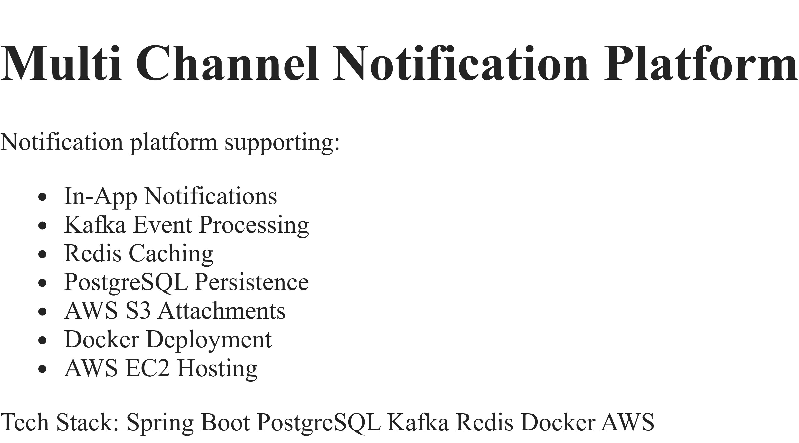

# notificationservice

POST /events

GET /users/{userId}/notifications

PUT /notifications/{id}/read

GET /users/{userId}/notifications/unread-count

Notification Table:

id

userId

sequenceNumber

type

title

message

status

createdAt

